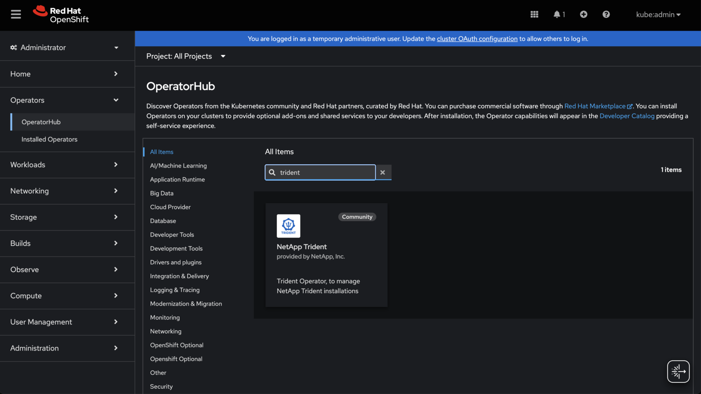
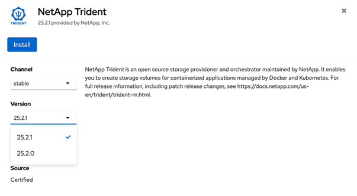
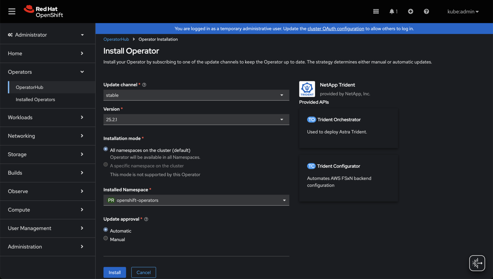
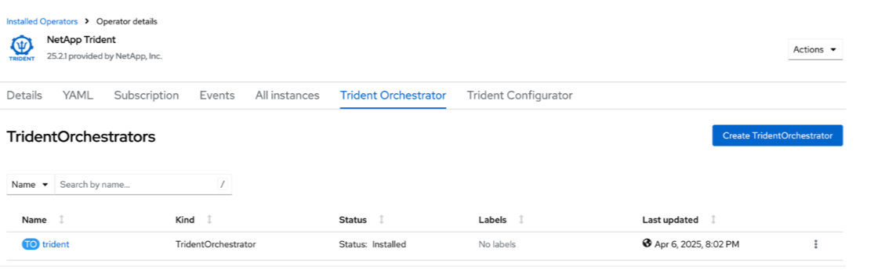

= Installare Trident utilizzando OpenShift OperatorHub
:hardbreaks:
:allow-uri-read: 
:icons: font
:imagesdir: ../media/

[role="lead"]
Se usate Red Hat OpenShift, potete installare NetApp Trident usando l'operatore certificato Red Hat. Utilizzate questa procedura per installare Trident dalla piattaforma contenitore di Red Hat OpenShift.

.Prima di iniziare
Prima di iniziare l'installazione, link:../trident-get-started/requirements.html["Preparare l'ambiente per l'installazione di Trident"].

[[find-and-install-the-trident-operator]]
== Individuare e installare l'operatore Trident

.Fasi
. Accedere a OpenShift OperatorHub e cercare NetApp Trident.
+

. Fare clic su * NetApp Trident* per aprire le impostazioni di installazione.
. Selezionare le opzioni richieste e fare clic su *Installa* per aprire la configurazione dell'operatore.
+

+

NOTE: Assicurati di selezionare la versione più recente dell'operatore.

. Mantieni tutti i parametri così come sono e fai clic su *Installa*.
+

. Fai clic su *View Operator* per visualizzare i dettagli dell'Operator. Seleziona la scheda *Trident Orchestrator*, quindi fai clic su *Create instance*.
. Nel modulo di creazione, seleziona *Visualizzazione YAML* e modifica l' `TridentOrchestrator`esempio fornito dalla UI. Non sostituirlo con una configurazione completa separata.
+
Per abilitare la concorrenza, aggiungi  `enableConcurrency: true` sotto la sezione  `spec:` esistente:

+
[source, yaml]
----
  enableConcurrency: true
----

[NOTE]
====
* Red Hat Enterprise Linux CoreOS (RHCOS) non ha iSCSI abilitato e configurato.
* Puoi aggiungere il `nodePrep` parametro per configurare e abilitare i servizi iSCSI e Multipath su tutti i nodi worker OpenShift.
* A partire da OpenShift 4.19, la versione minima Trident supportata per questa funzionalità è 25.06.1.

====
. Fare clic su *Crea*; Trident Orchestrator verrà installato completamente.
+

[[uninstall-trident-operator]]
== Disinstallare l'operatore Trident

.Fasi
. Selezionare l'operatore Trident dall'elenco degli operatori installati.
. Selezionare se si desidera eliminare tutte le istanze dell'operando dall'operatore.
+

WARNING: Se non si seleziona la casella di controllo *Elimina tutte le istanze dell'operando da questo operatore*, Trident non verrà disinstallato.

. Fare clic su *Disinstalla*.

